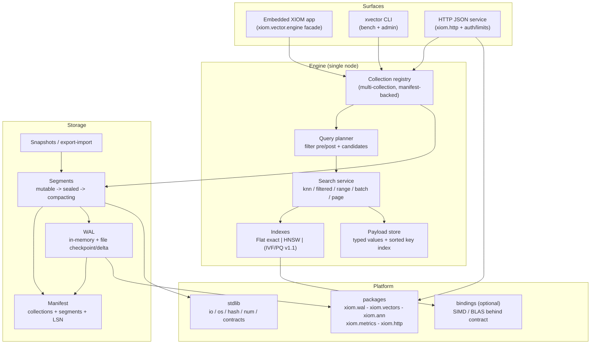

<!-- Copyright (c) 2026 Eleftherios Notas and The XIOM Authors -->
<!-- SPDX-License-Identifier: MIT OR Apache-2.0 -->

# xiom-xvector -- Production Plan (v1.0 flagship)

**Purpose:** the execution plan that takes xiom-xvector from a hardened
single-node engine (70 % weighted readiness, suite 169/169 x2 + 18 probes x2
on compiler v0.64.2) to a **production-grade, benchmarkable, releasable
vector database** that serves as the XIOM ecosystem's flagship.

**Companions:** `docs/requirements/production-v1.md` (intake),
`docs/checklists/production-v1.md` (step-by-step checklist),
`docs/PRODUCTION-READINESS.md` (scorecard), `docs/REL*-*.md` (lane relays).

---

## 0. Execution rules (unchanged lane discipline)

1. **One slice at a time.** A slice = one capability + its gates + docs.
2. **Verification contract per slice:** implement; add/extend a probe (and
   suite mirrors where the suite covers it); run suite **x2** + all probes
   **x2** on Windows; WSL spot (full WSL battery at wraps); `ci.ps1` +
   `ci.sh` green; signed conventional commits; docs updated in the same
   step (SPEC/ARCHITECTURE/SESSION/readiness as applicable).
3. **Red = rejection.** Numeric gates per build; rebuild + re-verify.
4. **Externally gated work is not idle work.** While the stdlib fsync chain
   is pending, work the non-gated slices; re-check the lanes each wrap.
5. **Owner gates the public release.** The lane reports when the release
   candidate is ready (R-milestone) and never pushes.

---

## 1. Target architecture (v1.0)

**Durability model:** WAL-before-ack; whole-file checkpoints with atomic
temp+rename today; delta append + `fsync` the moment the stdlib rows land;
manifest + segment files versioned and roundtripped; snapshots for backup.

**Index tiering:** exact Flat (oracle + small collections), HNSW (default
ANN), IVF/PQ (v1.1 scale tier). Segment-level immutable indexes with
fan-out + merge.

---

## 2. Capability target vs modern databases (v1.0)

| Capability | v1.0 target | Notes |
|---|---|---|
| Collections | multi, named, per-collection config | FR-1 |
| Metrics | cosine / dot / L2 | done |
| Exact search | Flat KNN + range oracle | range surface pending (Q1) |
| ANN | HNSW (tunable `m`/`ef_construction`/`ef_search`, tombstone-safe) | done, hardened |
| Filtering | typed AST, sorted index, pre/post planner, compound intersect | done (E 100 %) |
| Payloads | typed + `with_payload` hydration + updates/deletes | done |
| Batch / pagination | batch upsert/search, offset/after paging | Q2/Q3 |
| Delete-by-filter | selective delete with WAL + index upkeep | Q4 |
| Durability | WAL + atomic checkpoints + manifest + segments; fsync delta when stdlib lands | M-D |
| Crash tests | automated kill-matrix (prefix-exact + fsync path) | M-D5 |
| Server | HTTP JSON + auth + limits + graceful shutdown | M-S |
| Observability | metrics + health + structured logs | M-O |
| Backup | snapshot/export-import | M-D6 |
| Security | authn, validation, limits, fuzz/soak, SBOM | M-S4 |
| Performance | in-memory 1M-scale; SIMD seam; measured p99/QPS | M-P |
| Scale-out | **v2** (sharding/replication); IVF/PQ v1.1 | non-goal v1.0 |
| Hybrid search | **v1.1+** | non-goal v1.0 |

---

## 3. Milestones and slices (ordered)

### M-G -- Truth & measurement (start now; feeds everything)

Goal: every later number is measured, not assumed.

- **G1 reference-oracle cross-check -- DONE 2026-10-09** -- an independent
  in-repo oracle (Float64 reference math + metric identities/axioms:
  symmetry, triangle bounds, self-distance, normalization; randomized
  vectors, deterministic seeds) vs the engine kernels and search paths.
  Gate `probe_reference_oracle` (22 checks; deviations at Float32-ulp
  scale, bit-identical Windows/WSL).
- **G2 benchmark harness** (`bench/`) -- **DONE 2026-10-09**: deterministic
  workloads (ingest, KNN per metric/ef, filtered, range, batch, recovery),
  integer JSON + human report, CI smoke; `scripts/bench.ps1`/`.sh` twins.
- **G3 baseline report** -- **DONE 2026-10-09**: `docs/BENCHMARKS.md` with
  methodology, the n=5000 baseline, WSL spot, and the external-benchmark
  protocol notes; the harness found and fixed the O(L^2) `wal_persist`
  builder.

Exit: oracle probe green both platforms; one-command bench reproducible;
baseline committed.

### M-D -- On-disk durability (in progress; last slice stdlib-gated)

Goal: a kill never costs an acknowledged write on the available path.

- **D1 atomic checkpoint** -- `wal_persist` writes `path.tmp` then
  `io.rename` (available today); fault-injection probe: kill/interrupt
  between write and rename keeps the previous consistent file.
- **D2 manifest file -- DONE 2026-10-09** -- collection registry
  (name/dim/metric/index/params) persisted whole-file + atomic rename;
  load on open; migration fallback for the in-WAL manifest;
  `engine_manifest_save` + `engine_recover_file`/`open_engine`; gate
  `probe_manifest_file` (38 checks).
- **D3 multi-collection runtime + APIs -- DONE 2026-10-09** -- named
  collections (create/select/drop/list), per-collection isolation of
  stores/payloads/indexes, v2 config + v3 drop WAL records with cid-stamped
  data, routed recovery + whole-registry checkpoint; manifest-backed (D2)
  whole-registry `save_manifest`/`open_engine` (file-wins by name). Gate
  `probe_collections` (41 checks); legacy `create_collection` -> "default".
- **D4 segment files -- DONE 2026-10-09** -- sealed segments (vectors +
  payloads + HNSW codec) written whole-file + atomic rename; torn-tail-safe
  load; lifecycle Mutable -> Sealing -> Sealed wired; engine
  `seal_segment`/`restore_segment` (WAL re-checkpoint after restore). Gate
  `probe_segment_file` (38 checks). Multi-segment read path + thresholds
  stay with D5/D6 (P2 owns tuning).
- **D5 WAL delta + fsync + file-level kill test** *(gated: stdlib fsync /
  append-bytes)* -- append-only delta with `fsync` on commit; harness that
  spawns a child writer, kills it mid-append, and proves recovery has every
  acknowledged record; runs on Windows + WSL.
- **D6 retention + snapshots** -- checkpoint policy (compact + swap;
  truncate when stdlib lands), export/import snapshot format, restore drill.
  Probe `probe_snapshot`.

Exit: kill-matrix green; recovery time measured; formats versioned and
documented (SPEC); snapshots restore bit-exact stores.

### M-Q -- Query surface complete

Goal: the single-node query surface a modern DB is expected to have.

- **Q1 range search -- DONE 2026-10-09 (exact-first)** -- `search_range`
  engine/facade + `search_range_scan` kernel; exact on both index kinds
  (inclusive radius, distance-sorted, limit-bounded); gate
  `probe_range_search`. ANN widening deferred to M-P tuning; request range
  mode folded into Q6.
- **Q2 batch ops -- DONE 2026-10-09**: `upsert_many` / `delete_many` /
  `search_many` + `BatchHits`; all-or-nothing validation per call; gate
  `probe_batch_ops`. (Records are WAL-appended per point; an amortized
  batch-record format is a D5-era option, not required by the current
  semantics.)
- **Q3 pagination -- DONE 2026-10-09** -- stable `offset`/`after_id` paging
  over sorted hits with the (distance asc, id asc) tie-break documented
  (`query.pagination`; engine/facade `search_page`/`search_after`; exact
  on Flat and Hnsw). Gate `probe_pagination` (22 checks).
- **Q4 delete-by-filter -- DONE 2026-10-09** -- planner-driven selective
  delete (index candidates for Eq/Range/Exists/And-of-those, live-store
  scan for In/Or/Not), WAL-durable per point, graph tombstones, payload +
  index cleanup; ids collected before mutation + applied ascending (plan-
  independent WAL); nothing matching -> Ok(0). Gate `probe_delete_filter`
  (26 checks).
- **Q5 per-collection stats + index admin -- DONE 2026-10-09** --
  `collection_stats` (config, live points, payloads, Hnsw nodes +
  tombstones, shared WAL lsn; active from live fields, parked from
  registry entries) and `rebuild_index` (admin rebuild with
  before/after/reclaimed `IndexStats`; Hnsw fresh graph, Flat no-op;
  `compact_index` stays the Int wrapper). Gate `probe_index_admin`
  (20 checks).
- **Q6 request surface extensions -- DONE 2026-10-09** -- `SearchRequest`
  carries `mode` (knn/range), `radius`, and knn `offset`/`after_id`
  pagination (mutually exclusive; filters Knn-only); `SearchBatchRequest` +
  `HydratedBatch` + `search_batch_with_request` (ordered, all-or-nothing);
  metric/dimension/top_k validation unchanged. Gate `probe_search_request`
  extended to 24 checks.

Exit: probes for every path; suite mirrors where applicable; capability
matrix rows green.

### M-S -- Server & security

Goal: the service surface the ecosystem and benchmarks consume.

- **S1 HTTP service skeleton -- DONE 2026-10-09** -- in-repo
  `api.http_service` (transport-agnostic HTTP/1.1 byte pipeline: strict
  parse, router, stdlib-JSON wire with QUALIFIED `json.json_*` calls,
  byte-exact responses, honest statuses; no sockets until the `xiom.net`
  proof). Endpoints: `/health`, `/collections`, points get/upsert/delete,
  `/search` (knn/range/page/batch), `/stats`. Gate `probe_http_service`
  (40 checks). Config/limits/errors (S2), auth (S3) and the security pass
  (S4) layer on top of this handle.
- **S2 config + limits + errors -- DONE 2026-10-09** -- `ServiceConfig`
  (defaults + `XVECTOR_MAX_*` env + key=value file), enforced limits
  (request size/batch -> 413; named top_k/dim -> 400; boundaries
  accepted), the `{error,kind,status}` JSON model mapped from the full
  `CoreError` enum, and `http_service_shutdown` (drain + whole-file WAL
  checkpoint). Gate `probe_service_limits` (27 checks).
- **S3 auth** -- API keys (header, constant-time compare, scopes:
  read/write/admin), disabled-by-default only in embedded mode; rate
  limiting via `xiom.rate` if suitable, else minimal token bucket.
- **S4 security pass** -- threat model doc (asset/trust boundaries),
  HTTP input fuzzing + codec fuzz gates, resource-exhaustion tests,
  dependency pinning + SBOM, `unsafe` audit statement, secure defaults,
  docs/SECURITY.md.

Exit: service probe (start -> CRUD -> search -> shutdown) + abuse suite;
auth on by default; SECURITY.md committed.

### M-O -- Observability & operability

- **O1 metrics adoption** -- `xiom.metrics` wiring: counters (ops, errors,
  points, lsn), gauges (collections, segments, memory proxy), histograms
  (latency per op, recall proxy on demand).
- **O2 surfaces** -- `/metrics` + `/health` (liveness/readiness), structured
  logs (JSON lines) + slow-query log; probe asserts signals.
- **O3 runbook & failure modes** -- docs/OPERATIONS.md: start/stop,
  backup/restore drill, upgrade/migration, known failure domains
  (ARCHITECTURE 7 extended).

Exit: metrics probe; docs complete; ops drill passes.

### M-P -- Performance & scale

- **P1 concurrency design** -- design doc first (XIOM runtime reality):
  target model = process-level single-writer + read-only snapshots, or
  cooperative readers if the runtime permits; explicit consistency notes.
- **P2 memory budget + seal/compaction thresholds** -- bounded memory,
  segment sizing, compaction policy; measured.
- **P3 SIMD/BLAS seam** -- distance kernels behind the `xiom.vectors`
  contract; bindings accelerate when available; benchmark deltas recorded.
- **P4 IVF/PQ prototype** (v1.1 track) -- quantized storage, recall/latency
  curve vs HNSW.
- **P5 mmap/disk segments** (stdlib-dependent) -- tiered storage.

Exit: 1M-vector in-memory workload within published latency/QPS targets;
roadmap to 10M with measured extrapolation.

### M-R -- Release candidate & owner handoff

- **R1** release checklist completion (`docs/RELEASE-CHECKLIST.md`), version
  `1.0.0-rc`, changelog, build-info stamp.
- **R2** CI matrix green (Windows + WSL); reproducible artifacts.
- **R3** benchmark report + methodology; security checklist + SBOM.
- **R4** owner handoff package: setup steps (repo public, runners,
  rulesets, publish flow) mirroring PULSE; **the lane tells the owner it is
  ready before any public action**.

Exit: owner performs the public release; the owner's benchmark can drive
the DB through the documented protocol.

### M-v2 (programme after v1.0)

Distribution (sharding/replication/consistency), hybrid dense+sparse,
deep quantization + tiered storage, client SDKs.

---

## 4. Immediate slice backlog (first 12, ordered)

| # | Slice | Milestone | Gate |
|---|---|---|---|
| 1 | Atomic checkpoint (temp+rename) | D1 | `probe_wal_file` extension + suite x2 + probes x2 |
| 2 | Range search -- **DONE 2026-10-09** (exact-first; ANN widening -> M-P) | Q1 | `probe_range_search` vs brute force |
| 3 | Batch ops -- **DONE 2026-10-09** | Q2 | `probe_batch_ops` (14 checks) |
| 4 | Benchmark harness + baseline | G2/G3 | `bench.ps1/bench.sh` green; `docs/BENCHMARKS.md` committed -- **DONE 2026-10-09** |
| 5 | Manifest file -- **DONE 2026-10-09** | D2 | `probe_manifest_file` (38 checks) |
| 6 | Multi-collection -- **DONE 2026-10-09** | D3/FR-1 | `probe_collections` (41 checks) |
| 7 | Pagination -- **DONE 2026-10-09** | Q3 | `probe_pagination` (22 checks) |
| 8 | Delete-by-filter -- **DONE 2026-10-09** | Q4 | `probe_delete_filter` (26 checks) |
| 8b | Index admin + per-collection stats -- **DONE 2026-10-09** | Q5 | `probe_index_admin` (20 checks) |
| 8c | Request extensions (mode/page/batch) -- **DONE 2026-10-09** | Q6 | `probe_search_request` (24 checks) |
| 9 | Reference oracle -- **DONE 2026-10-09** | G1 | `probe_reference_oracle` (22 checks) |
| 10 | HTTP skeleton + health -- **DONE 2026-10-09** | S1 | `probe_http_service` (40 checks) |
| 11 | Config/limits/errors -- **DONE 2026-10-09** | S2 | `probe_service_limits` (27 checks) |
| 12 | Auth | S3 | auth probe (reject/accept, scopes) |

Gated items (D5 fsync chain, P5 mmap, truncate-based retention) are picked
up the moment the stdlib lane lands the primitives; re-check every pass.

---

## 5. Benchmark programme (benchmark-ready for the owner)

- **Harness:** `bench/` runner with deterministic seeds; workloads:
  W1 ingest N vectors (dim configurable), W2 KNN (metric × ef sweep),
  W3 filtered (selective + majority), W4 range, W5 batch, W6 mixed soak,
  W7 kill/recover timing. Output: JSON + markdown tables.
- **Metrics:** QPS, p50/p95/p99, recall@k vs exact oracle on a fixed
  sample, build time, bytes/vector, recovery time.
- **Datasets:** synthetic (LCG) built-in; importers for fvecs / JSONL /
  CSV so the owner's benchmark can feed real data (SIFT1M-class).
- **Protocol for external benches:** stable CLI (`xvector-bench --data ...
  --queries ... --json out.json`) + later the HTTP service; documented in
  `docs/BENCHMARKS.md` with methodology and hardware notes.
- **Honesty rule:** every published number names the workload, dataset,
  parameters, platform, compiler/stdlib versions.

## 6. Security programme

- **Auth & transport:** API keys (scopes, constant-time compare); TLS
  documented per deployment (bindings/stdlib dependent); secure defaults.
- **Validation:** every boundary (HTTP, facade) validates dims/k/batch/
  filter shapes via contracts; malformed inputs rejected with typed errors.
- **Resource safety:** request size, connection, batch, and memory caps;
  slow-query logging; no unbounded scans without limits.
- **Robustness:** fuzz gates (codecs, HTTP), soak, kill-matrix; every
  `Some`/`Ok` invariant checked in probes.
- **Supply chain:** pinned stdlib/packages, SBOM, signed commits,
  no secrets in-repo, release artifacts stamped.
- **XIOM safety story:** product code has no user-level `unsafe`;
  contracts encode invariants; document the guarantee in SECURITY.md.

## 7. Ecosystem integration map

| Ecosystem piece | How the flagship uses it | Lane action |
|---|---|---|
| compiler contracts | invariants on entry points; per-build numeric gates | relay findings; keep probes pinned |
| stdlib | io/os/hash/num; the durability primitives gate M-D5 | wishlist relays per pass |
| `xiom.wal` | single WAL home; codec alignment; crash probes contributed | adopt on publish (ops allowlist) |
| `xiom.vectors` / `xiom.ann` | porter extraction of this lane's reference implementation | on owner greenlight |
| `xiom.metrics` | O1 observability | adopt Phase 10 (now) |
| `xiom.http` / `xiom.router` / `xiom.rate` | server surface | adopt at S1/S3; fallback in-repo |
| bindings (blas/eigen) | optional SIMD acceleration behind the contract | watch; never required |

## 8. Risks and external gates

| Risk / gate | Impact | Mitigation |
|---|---|---|
| stdlib fsync/fd/append still stubs on 0.64.3 | D5 (true durability), truncate retention, KV/manifest backends | atomic checkpoint path ships now; re-check each pass; relay pressure; `xiom.wal` shares the gate |
| `xiom.http`/`xiom.metrics` maturity | S1/O1 may need in-repo fallback | facade-first design; adopt when the package proves itself |
| XIOM runtime concurrency model | P1 limits throughput story | design first; process-level model; publish honest numbers |
| compiler regressions on new archives | red builds | per-build numeric gates; re-test at every archive before pinning |
| benchmark fairness | credibility | publish methodology + raw JSON; deterministic seeds |
| single-lane bandwidth | long timeline | strict slice cadence; owner gates release only |
| security surface of a young HTTP stack | exposure | secure defaults, auth on, threat model, fuzz gates before release |

## 9. Definition of "public release ready" (what the lane delivers)

1. Suite + probes green x2 on Windows and WSL through `ci.ps1`/`ci.sh`.
2. Kill-matrix + snapshot/restore evidence committed.
3. Benchmark report (`docs/BENCHMARKS.md`) with methodology + raw JSON.
4. Security checklist + SBOM + `docs/SECURITY.md`.
5. Docs complete (README/quickstart/API/OPERATIONS/ARCHITECTURE) and
   release checklist filled; `VERSION` = `1.0.0-rc`.
6. Release candidate tagged; owner handoff note (repo/runners/rulesets/
   benchmark setup) -- **the lane stops and tells the owner**.

## 10. Cadence and reporting

- Work proceeds autonomously slice-by-slice under the lane's goal loop;
  each slice is committed signed with its probes/docs.
- Every wrap: SESSION.md STATE refreshed, readiness re-scored, lanes
  re-checked, relays updated.
- The lane reports to the owner at: (a) each milestone exit,
  (b) any new external gate, (c) the release-ready gate (R4).
